# Jambo – Design Document

## Table of Contents

1. [Project Overview](#1-project-overview)
2. [Architecture Diagrams](#2-architecture-diagrams)
3. [Backend Module Roles](#3-backend-module-roles)
4. [API Reference](#4-api-reference)
5. [Use Cases](#5-use-cases)
6. [WebSocket & Redis Pub/Sub](#6-websocket--redis-pubsub)
7. [AI Worker Mechanisms](#7-ai-worker-mechanisms)
8. [Scheduler Worker Mechanisms](#8-scheduler-worker-mechanisms)
9. [Frontend Components & Wirings](#9-frontend-components--wirings)
10. [Game Service Layer](#10-game-service-layer)
11. [Cache Mechanisms](#11-cache-mechanisms)
12. [Scalability Mechanisms](#12-scalability-mechanisms)
13. [Fallback Mechanisms](#13-fallback-mechanisms)
14. [Metrics](#14-metrics)
15. [Internationalization (i18n)](#15-internationalization-i18n)
16. [Logging & Debugging](#16-logging--debugging)
17. [Database Schema](#17-database-schema)
18. [Performance Expectations](#18-performance-expectations)

---

## 1. Project Overview

A real‑time, multiplayer card game (Jambo) with:

- **Quick solo games**: A human vs. 3 AI bots playing a 5-card trick-taking game.
- **Multiplayer games**: Up to 4 human players via invitations, game runs, and rooms.
- **Bot AI**: Six zone-based strategies; dispatched via RabbitMQ or synchronous fallback.
- **Real‑time events**: Redis Pub/Sub → sharded WebSocket delivery.
- **Full‑stack Rust/React**: Actix-Web 4 backend + React 18/TypeScript frontend.

### Technology Stack

| Layer | Technology |
|-------|-----------|
| Backend | Rust, Actix-Web 4, SeaORM 2, Tokio |
| Database | PostgreSQL (via SeaORM migrations) |
| Message Queue | RabbitMQ (AMQP via `lapin`) |
| Pub/Sub | Redis 7 (`game:*`, `room:*` channels) |
| Frontend | React 18, TypeScript, Vite, Tailwind CSS, Zustand |
| I18n | Backend: `Translator` + JSON; Frontend: `i18next` |
| Metrics | Prometheus (`/metrics` endpoint, 42+ families) |
| Tracing | `tracing` + CorrelationId (HTTP → Redis → RabbitMQ → WS) |
| Payments | PayPal REST API (unfreeze + topup + cashout payouts) |

### Game Rules Summary

- **Deck**: 32 cards (0–31), 4 suits × 8 ranks (3–10)
- **4 players per game**, **5 cards each** = 5 rounds per game
- **Suit‑following rule**: must play a card of the leading suit if you hold one
- **KORA**: when the round‑winning card is a 3 (`index % 8 == 0`)
  - `Kora` (1× multiplier): round starter is NOT the winner
  - `DoubleKora` (2× multiplier): round starter IS the winner
  - KORA events end the game immediately with amplified payouts
- **Special cards** (evaluated per 5‑card hand at game start): `triple_seven`
  (3+ sevens), `sum_under_21` (sum of ranks < 21), `a_square` (four of a kind).
  Strength: `a_square` > `sum_under_21` > `triple_seven`. The unique top holder
  is offered a claim (immediate win) or may decline; an unclaimed combo held by
  the winner upgrades the result to `Kora`.
- **Cashout**: player requests a payout (multiple of `CASHOUT_CREDITS_PER_EUR`,
  min `CASHOUT_MIN_CREDITS`, cap `CASHOUT_MAX_EUR_CENTS`) to a PayPal account.
  Credits are reserved and the profile locked until an admin approves/rejects
  (1‑day auto‑reject fallback); payout via PayPal Payouts.

**Card index → suit/rank mapping:**

```
suit = index / 8    (Hearts=0, Spades=1, Diamonds=2, Clubs=3)
rank = index % 8    (3=0, 4=1, 5=2, 6=3, 7=4, 8=5, 9=6, 10=7)
KORA = index % 8 == 0
```

### Binary Targets (5 crates, 7 binaries)

| Binary | Crate | Source |
|--------|-------|--------|
| `jambo-server` | `jambo-server` | `crates/jambo-server/src/main.rs` — HTTP/WS server, routes, Prometheus metrics |
| `ai-worker` | `jambo-ai-worker` | `crates/jambo-ai-worker/src/main.rs` — RabbitMQ consumer for bot moves |
| `scheduler-worker` | `jambo-scheduler-worker` | `crates/jambo-scheduler-worker/src/main.rs` — background task runner |
| `admin-cli` | `jambo-admin-cli` | `crates/jambo-admin-cli/src/main.rs` — admin CLI |
| `load-test` | `jambo-load-tests` | `crates/jambo-load-tests/src/bin/load_test.rs` (feature `load-tests`) |
| `http-load-test` | `jambo-load-tests` | `crates/jambo-load-tests/src/bin/http_load_test.rs` (feature `load-tests`) |
| `ws-load-test` | `jambo-load-tests` | `crates/jambo-load-tests/src/bin/ws_load_test.rs` (feature `load-tests`) |

---

## 2. Architecture Diagrams

### 2.1 High‑Level System Overview

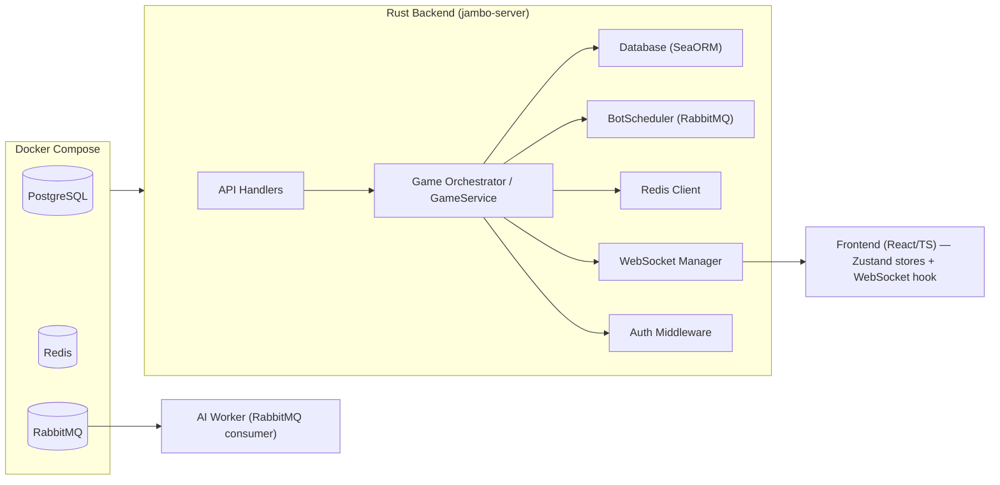

### 2.2 Backend Crate Dependency Graph

The backend is a Cargo **workspace** of 15 crates plus the `migration` crate
(`backend/Cargo.toml`: `members = ["crates/*", "migration"]`). Edges point from
a crate to the workspace crates it must compile against (`A --> B` = "A depends
on B").

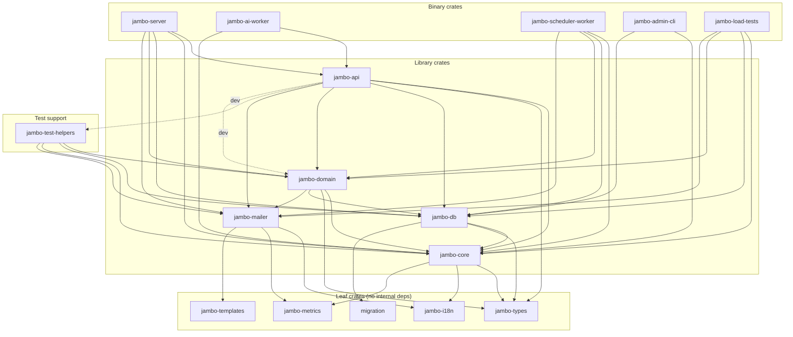

| Crate | Role | Workspace deps |
|-------|------|----------------|
| `jambo-types` | Shared DTOs, cards, constants | - |
| `jambo-i18n` | Translations | - |
| `jambo-metrics` | Prometheus registry/init | - |
| `jambo-templates` | Handlebars email templates | - |
| `migration` | SeaORM migrations | - |
| `jambo-core` | Config, auth utils, observability, i18n, payment | types, i18n, metrics |
| `jambo-mailer` | Email queue + SMTP/noop mailer | i18n, metrics, templates |
| `jambo-db` | SeaORM entities + repositories | core, types, migration |
| `jambo-domain` | Game engine, rooms, messaging, cache | core, types, db, mailer |
| `jambo-api` | HTTP handlers, websocket, worker | core, types, db, domain, mailer |
| `jambo-server` | API binary (bootstrap + routes) | api, core, db, domain, mailer |
| `jambo-ai-worker` | AI bot-move consumer binary | api, core |
| `jambo-scheduler-worker` | Background scheduler binary | core, db, domain, mailer |
| `jambo-admin-cli` | Admin CLI binary | core, db |
| `jambo-load-tests` | Load-test binaries | core, db, domain, mailer |
| `jambo-test-helpers` | Test fixtures/factories | domain, db, core, mailer |

### 2.3 Request Lifecycle (Card Play Sequence)

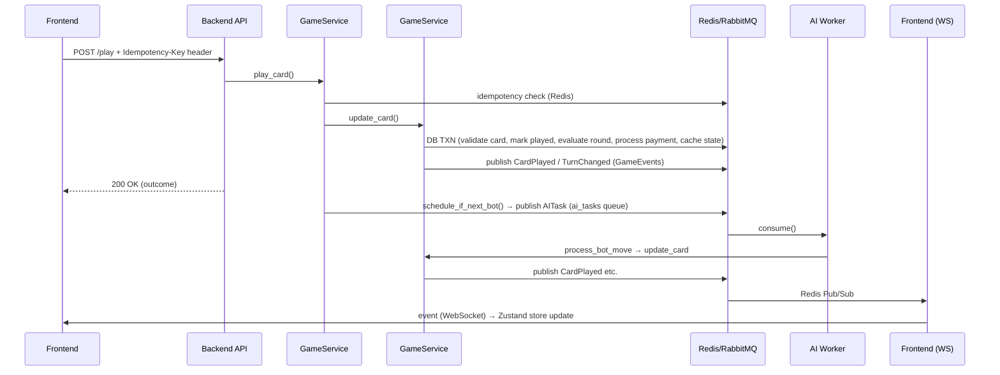

### 2.4 Multiplayer Game Lifecycle State Machine

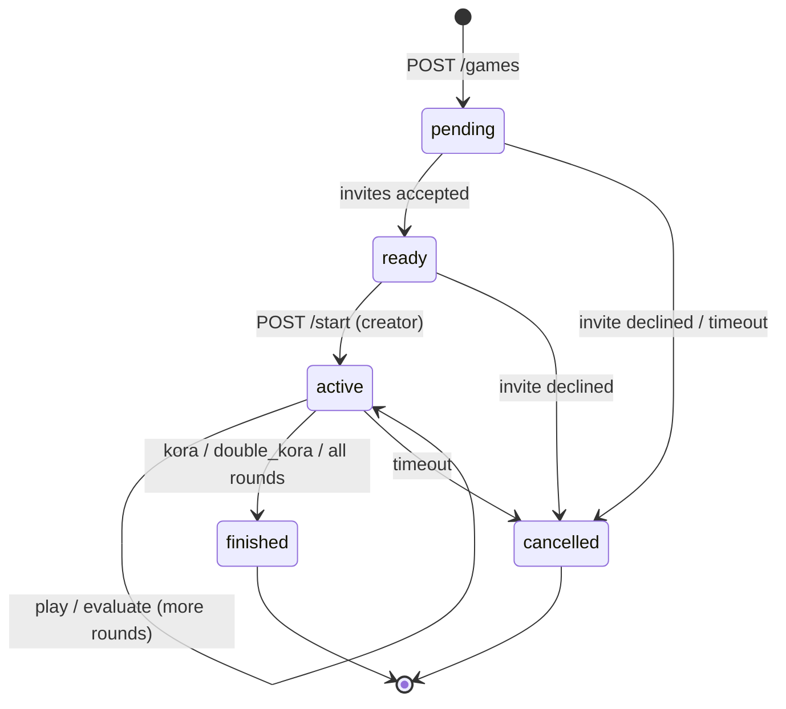

### 2.5 Game Run Lifecycle (Rooms)

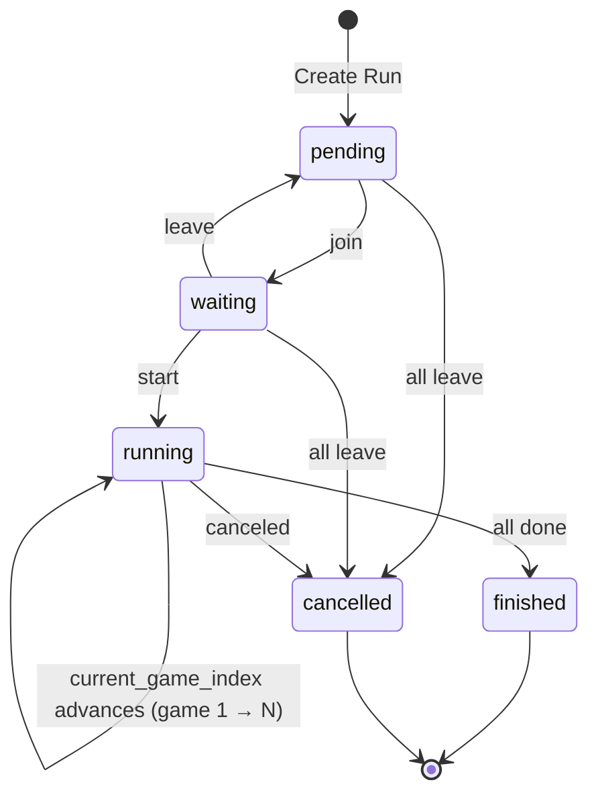

### 2.6 Backend Service Composition

At startup `bootstrap.rs` builds the `AppState` services injected into every
handler via Actix `web::Data`. This graph shows each service, the repositories
it owns, and the external systems it reaches.

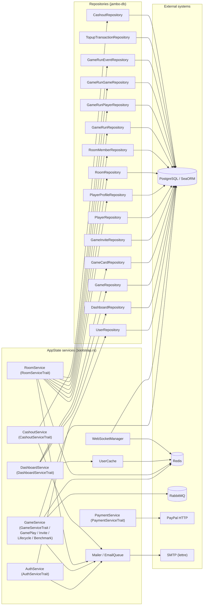

> `GameService` is the single "orchestrator" struct that implements the
> `GameServiceTrait`, `GamePlayService`, `InviteService`, `GameLifecycleService`
> and `BenchmarkService` traits (see `jambo-domain/src/game/service/`). The
> WebSocket layer publishes events to Redis; the manager only subscribes — it
> never calls `GameService`/`RoomService` directly.

---

## 3. Backend Crate Roles

The backend is a Cargo **workspace** (`backend/Cargo.toml`) split into 15 crates
(see §2.2 for the dependency graph).

### 3.1 `jambo-api` — HTTP handlers, WebSocket, worker

| Module | Role |
|--------|------|
| `api/` | Actix handlers (`auth`, `dashboard`, `game`, `quickie`, `room`, `topup`, `unfreeze`, `cashout`, `leaderboard`, `contact`, `benchmark`, `fallback`, `system`, `anonymous`, `config`) + `middleware/` (rate limiter, idempotency, ip-forward) + `services/` (`AuthService`, `DashboardService`, `CashoutService`, game-state builder) |
| `auth/` | `AuthConfig`, JWT validation, `AuthMiddleware`, cookie + bearer extractors |
| `websocket/` | WS endpoints (`/ws/{game_id}`, `/ws/room/{id}`, `/ws/me`), `manager/` (connection maps, sharded Redis subscriber, cleanup, spectators), message enums |
| `worker/` | RabbitMQ consumer loop + metrics server (AI worker runtime) |

### 3.2 `jambo-domain` — Core domain logic

| Module | Role |
|--------|------|
| `game/` | `GameService` (transactional engine: gameplay, evaluation, creation, lifecycle, recovery, caching, invites, claims, card-play), `BotScheduler`, `worker_core`, `strategy`, `bot`, card mapping/constants/distribution/turn-order/round-evaluation |
| `room/` | `RoomService` (rooms, members, game runs, start-next-game), `StartNextGameService` |
| `messaging/` | `RedisClient` (pub/sub + cache), `RabbitMQClient` (circuit breaker, DLX/DLQ), `events` (`GameEvent`/`RoomEvent`/`UserEvent`), `AITask` |
| `cache/` | `UserCache`, `leaderboard` (Redis sorted sets) |
| `scheduler/` | `Scheduler` + 7 background tasks |

#### Randomness & Card Dealing

All randomness in the game engine is delegated to the [`rand`](https://crates.io/crates/rand) crate
(v0.10) rather than hand‑rolled seeding. There is **no `srand()`/seed parameter** — this is deliberate:

- **Source**: `rand::rng()` returns the thread‑local CSPRNG (ChaCha12), which is automatically
  seeded from the OS entropy source (`getrandom`, i.e. `/dev/urandom` / `RDRAND` / syscalls).
  No explicit seed is supplied anywhere in the codebase.
- **Card dealing**: `distribution.rs` builds the 32 card indices, then applies a Fisher–Yates
  shuffle via `cards.shuffle(&mut rng)` (`SliceRandom`). This is unbiased and guarantees a uniform
  random permutation, from which each of the 4 players is dealt 5 cards.
- **Turn selection**: `quick_game.rs` picks the opening player with
  `rand::rng().random_range(0..4)`.
- **Bot strategy selection**: `strategy.rs::StrategyChoice::random_high()` uses
  `choices.choose(&mut rng)` (`IndexedRandom`) to pick among `LongUp`/`LongDown`/`MidUp`/`MidDown`.

Using OS entropy (rather than a hand‑picked "big seed number") is *stronger*: the seed is
cryptographically random per call, is not stored in code or config, and each invocation of
`rand::rng()` draws fresh entropy without introducing predictable global state.

### 3.3 `jambo-db` — Persistence layer

| Module | Role |
|--------|------|
| `lib.rs` | `create_connection()` (configurable pool), `run_migrations()` (embeds the `migration` crate) |
| `models/` | SeaORM entities: `game`, `player`, `game_card`, `user`, `player_profile`, `game_invite`, `room`, `room_member`, `game_run`, `game_run_player`, `game_run_game`, `game_run_event`, `admin_key`, `cashout_request`, `topup_transaction` + enums |
| `repositories/` | Concrete repos: `user`, `dashboard`, `game`, `game_card`, `game_invite`, `player`, `player_profile`, `room`, `game_run*`, `cashout`, `topup_transaction`, `admin_key`, `admin_report` |
| `traits.rs` | Repository trait abstractions (e.g. `GameRepoTrait`, `PlayerRepoTrait`) for testability |

### 3.4 `jambo-core` — Cross-cutting infrastructure

| Module | Role |
|--------|------|
| `config.rs` | `Config` struct built from env vars (database, RabbitMQ, Redis, JWT, CORS, rate limits, game settings, PayPal, benchmarks) |
| `i18n/` | `Lang` enum (En, Fr), `Translator`, `I18n` extractor, language endpoints (re-exports `jambo-i18n`) |
| `observability/` | `CorrelationId`, correlation middleware, tracing init, `metrics` (re-exported from `jambo-metrics`) |
| `payment/` | `PaymentService` wrapping the PayPal REST API (`/v2/checkout/orders`) |
| `error/` | `AppError`, `GameError` (wraps `ValidationError`, `NotFound`, etc.) with `ResponseError` |

### 3.5 Supporting crates

| Crate | Role |
|-------|------|
| `jambo-mailer` | `Mailer` trait + `SmtpMailer` (Lettre) + `NoopMailer` (testing) + `EmailQueue` |
| `jambo-metrics` | Prometheus metric families |
| `jambo-i18n` | Translation resources (`en.json`/`fr.json`) |
| `jambo-templates` | Handlebars email templates |
| `jambo-types` | Shared DTOs, card/special-card types, constants |
| `jambo-test-helpers` | Test fixtures/factories |

---

## 4. API Reference

> **Note**: This project uses manual Actix‑Web route definitions (`routes.rs`). `utoipa` could be integrated for OpenAPI 3.1 generation — all DTOs already use `serde::Serialize`/`Deserialize`, and the macro‑based `#[derive(ToSchema)]` would slot in with minimal refactoring.

### 4.1 Public Endpoints (No Auth)

| Method | Path | Rate Limit | Purpose |
|--------|------|-----------|---------|
| `GET` | `/health` | — | Health check (`"OK"`) |
| `GET` | `/metrics` | — | Prometheus text metrics |
| `GET` | `/api/anonymous` | — | Anonymous dashboard stats |
| `POST` | `/api/quickie` | — | Create solo quick game |
| `GET` | `/api/config` | — | Client‑side configuration |
| `POST` | `/api/contact` | 5/min | Contact form |
| `POST` | `/api/lang` | — | Set language cookie |
| `GET` | `/api/lang` | — | Get current language |
| `GET` | `/api/languages` | — | List available languages |
| `POST` | `/api/auth/register` | 3/hour | Create account |
| `POST` | `/api/auth/login` | 10/min | Login, returns JWT |
| `POST` | `/api/auth/logout` | — | Logout (revokes token) |
| `POST` | `/api/auth/forgot-password` | 3/hour | Send password reset email |
| `POST` | `/api/auth/reset-password` | 10/min | Reset password with token |
| `GET` | `/api/auth/me` | — | Current user info (requires JWT) |
| `POST` | `/api/game/{id}/play` | — | Play a card (cookie JWT or one-time game token) |
| `POST` | `/api/game/{id}/advance-bot` | — | Advance a bot move |
| `POST` | `/api/game/{id}/evaluate-round` | — | Evaluate the round |
| `POST` | `/api/game/{id}/claim-special` | — | Claim a special-card victory |
| `POST` | `/api/game/{id}/decline-special` | — | Decline a special-card claim |

### 4.2 Authenticated Endpoints (`/api/me/`)

| Method | Path | Purpose |
|--------|------|---------|
| `GET` | `/profile` | User profile (credits, wins, streak, freeze status) |
| `GET` | `/games` | List user games (paginated, filterable) |
| `POST` | `/games` | Create new game (solo or multiplayer) |
| `GET` | `/games/{game_id}` | Game details |
| `GET` | `/active-game` | Current active game |
| `GET` | `/invitations` | Pending game invitations |
| `GET` | `/leaderboard` | Global leaderboard (Redis sorted set) |
| `POST` | `/unfreeze` | Create PayPal unfreeze order |
| `POST` | `/unfreeze/capture` | Capture PayPal unfreeze order |
| `POST` | `/topup` | Create PayPal topup order |
| `POST` | `/topup/capture` | Capture PayPal topup order |
| `POST` | `/cashout` | Request cashout |
| `GET` | `/cashout` | List cashout requests |
| `POST` | `/rooms` | Create room |
| `GET` | `/rooms` | List user rooms |
| `POST` | `/rooms/join` | Join room by invitation code |
| `GET` | `/rooms/{room_id}` | Room details |
| `POST` | `/rooms/{room_id}/invite` | Invite user to room |
| `POST` | `/rooms/{room_id}/leave` | Leave room |
| `POST` | `/rooms/{room_id}/runs` | Create game run |
| `GET` | `/rooms/{room_id}/runs` | List game runs |
| `GET` | `/rooms/{room_id}/runs/active` | Active run in room |
| `POST` | `/runs/{run_id}/join` | Join a game run |
| `POST` | `/runs/{run_id}/leave` | Leave a game run |
| `POST` | `/runs/{run_id}/next-game` | Start next game in run |
| `GET` | `/runs/{run_id}/current-game` | Current game in run |

### 4.3 Authenticated Game Management (`/api/games/`)

| Method | Path | Purpose |
|--------|------|---------|
| `POST` | `/{game_id}/invites` | Send game invitations |
| `POST` | `/{game_id}/respond` | Accept/decline invitation |
| `POST` | `/{game_id}/start` | Start multiplayer game |
| `POST` | `/{game_id}/play` | Play a card (with idempotency key) |
| `GET` | `/{game_id}/me` | Game state for authenticated player |
| `POST` | `/{game_id}/spectate-token` | Mint a spectator token |

### 4.4 Other Authenticated Endpoints

| Method | Path | Purpose |
|--------|------|---------|
| `GET` | `/api/users/search` | Search users by pseudo |
| `POST` | `/api/benchmark/create-multiplayer-game` | (benchmark mode) Create test game |
| `POST` | `/api/benchmark/cleanup` | (benchmark mode) Clean test data |

### 4.5 WebSocket Endpoints

| Path | Auth | Purpose |
|------|------|---------|
| `GET /ws/{game_id}` | JWT or one-time `?token=` | Game events (CardPlayed, RoundCompleted, etc.) |
| `GET /ws/room/{room_id}` | JWT required | Room events (MemberJoined, RunCreated, etc.) |
| `GET /ws/me` | JWT required | User-scoped events (InviteReceived, InviteRemoved) |

### 4.6 PayPal Endpoints

| Method | Path | Purpose |
|--------|------|---------|
| `GET` | `/api/paypal/return` | Unfreeze return URL |
| `GET` | `/api/paypal/cancel` | Unfreeze cancel URL |
| `GET` | `/api/paypal/topup/return` | Topup return URL |
| `GET` | `/api/paypal/topup/cancel` | Topup cancel URL |

### 4.7 Game Event Types (Serialized as JSON)

| Event | Fields | Published When |
|-------|--------|---------------|
| `CardPlayed` | `game_id, player_id, card_index, next_turn?, correlation_id?` | Any player plays a card |
| `RoundCompleted` | `game_id, round_number, winner_id, winner_position, win_type?, deck_slots[]` | All 4 players played in round |
| `GameFinished` | `game_id, winner_id?, winner_name?, winner_position?, status, final_score?, rounds_played` | Game reaches terminal state |
| `TurnChanged` | `game_id, current_turn` | Turn passes to next player |
| `PlayerJoined` | `game_id, player_id, user_id, pseudo, position, player_count, max_players` | Human joins pending multiplayer game |
| `GameCancelled` | `game_id, reason` | Game is cancelled |
| `GameReady` | `game_id` | Minimum players reached, game ready to start |
| `CardsDealt` | `game_id, player_id, cards[]` | Cards dealt to a specific player (private) |
| `GameStarted` | `game_id, players[], current_turn` | Game starts (personalized display positions) |
| `PlayerDisconnected` | `game_id, player_id, player_position` | Player WebSocket disconnects |
| `PlayerReconnected` | `game_id, player_id, player_position` | Player WebSocket reconnects |
| `StalenessWarning` | `game_id, player_id, player_name, kicked_after_seconds` | Human is inactive; warning sent |
| `PlayerKicked` | `game_id, player_id, player_name` | Human kicked for inactivity |
| `GameReshuffled` | `game_id, remaining_players` | After kick, remaining players reshuffled |
| `PlayerForfeitWin` | `game_id, winner_id, winner_name` | Only one player remains |

### 4.8 Room Event Types

| Event | Fields | Published When |
|-------|--------|---------------|
| `MemberJoined` | `room_id, user_id, pseudo` | User joins room |
| `MemberLeft` | `room_id, user_id, pseudo` | User leaves room |
| `RunCreated` | `room_id, run_id, num_games, bet_per_game` | New game run created |
| `GameStarted` | `room_id, run_id, game_id, game_index, total_games` | Next game in run starts |
| `RunCompleted` | `room_id, run_id` | All games in run finished |

### 4.9 Endpoint -> Service -> Repository Graphs

Legend: each endpoint handler reads services from `web::Data` (`routes.rs`),
the services call repositories (`jambo_db::repositories::*`), and repositories
(or the handler directly) reach external systems (`Redis`, `RabbitMQ`,
`PayPal`, `SMTP`).

#### Auth (`/api/auth/*`)

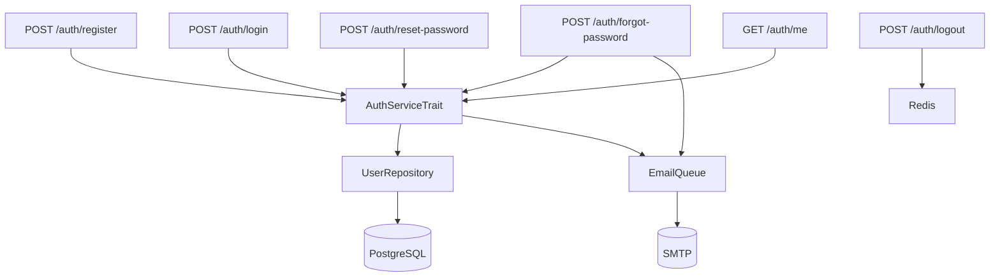

#### Public / misc

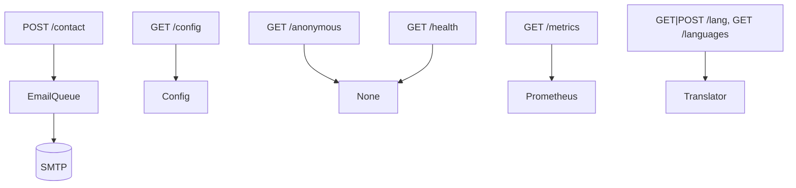

#### Dashboard & profile (`/api/me/*`)

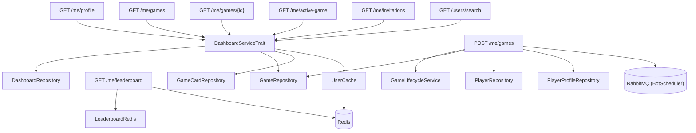

#### Game management (`/api/games/*`)

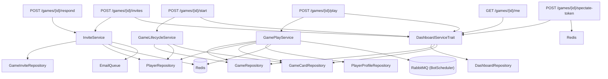

#### Payments (`/api/me/unfreeze`, `/api/me/topup`, `/api/me/cashout`)

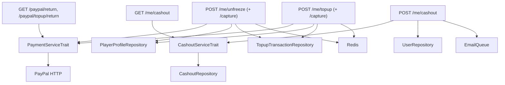

#### Rooms & runs (`/api/me/rooms`, `/api/me/runs`)

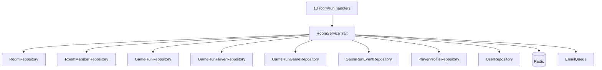

#### Game actions & quick game

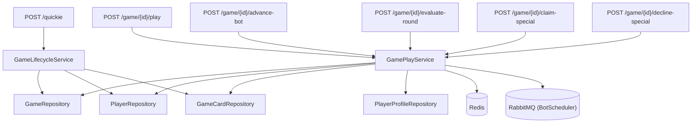

#### Benchmark (benchmark mode only)

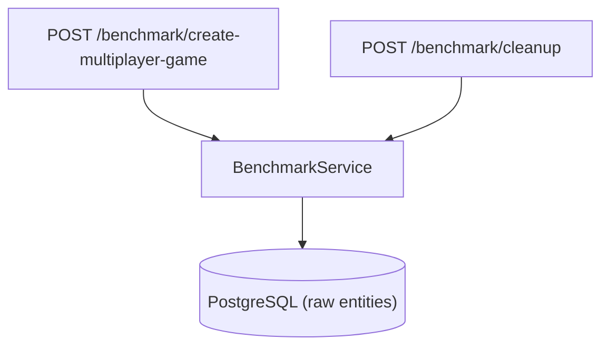

#### WebSocket

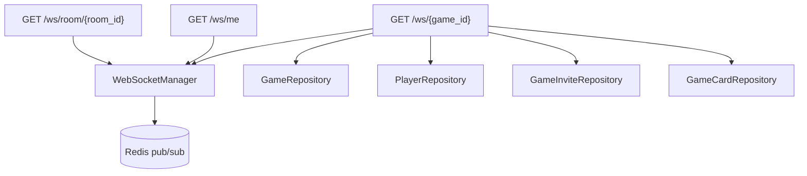

*(Full WebSocket detail is in section 6.)*

---

## 5. Use Cases

### UC1: Anonymous Dashboard
1. User opens the app.
2. Frontend calls `GET /api/anonymous`.
3. Dashboard displays games played count and active players.

### UC2: Quick Solo Game
1. User clicks "Start Game".
2. Frontend calls `POST /api/quickie`.
3. `GameLifecycleService::create_quick_game()`:
   a. Creates `Game` (solo mode, pending → active).
   b. Creates 4 `Player` rows (1 human, 3 bots with random strategies).
   c. Distributes 5 cards to each player (20 GameCard rows).
   d. Sets `current_turn` randomly.
4. Returns `QuickGameResponse` (game_id, players, bet, status).
5. Frontend opens WebSocket `GET /ws/{game_id}`.
6. If first turn is a bot, `BotScheduler` dispatches `AITask` to RabbitMQ.

### UC3: Human Plays Card (Authenticated)
1. User clicks a card in their hand.
2. Frontend sends `POST /api/games/{game_id}/play` with `X-Idempotency-Key`.
3. `GamePlayService::play_card()`:
   a. Checks idempotency in Redis (`idem:{player_id}:{key}`, TTL 300s).
   b. Validates: game active, player's turn, card owned, suit‑following rule.
   c. Calls `GameService::update_card_play()` (3‑retry optimistic lock transaction).
   d. Publishes `CardPlayed` + optionally `TurnChanged`, `RoundCompleted`, `GameFinished`.
   e. Schedules bot if next player is a bot.
4. Returns `PlayCardOutcome`.
5. WebSocket delivers events → frontend store updates.

### UC4: Bot Plays Card (Async via RabbitMQ)
1. `BotScheduler::schedule_if_next_bot()` detects next player is a bot.
2. `GameService::build_ai_task()` constructs `AITask` with full game state.
3. `BotScheduler` publishes `AITask` to RabbitMQ `ai_tasks` queue.
4. `ai-worker` binary consumes the task:
   a. Acquires per‑game semaphore (serialization).
   b. Global semaphore(50) limits concurrency.
   c. Calls `process_bot_move()`:
     - `execute_bot_move_from_task()` computes card from strategy.
     - Calls `GameService::update_card_play()` for DB transaction.
   d. If next player is also bot, publishes next `AITask` to RabbitMQ.
5. Events published to Redis → WebSocket → frontend.

### UC5: Bot Plays Card (Sync Fallback)
1. RabbitMQ unavailable → `BotScheduler::run_sync_chain()`.
2. Reads game state from DB, computes move via `execute_bot_move()`.
3. Calls `GameService::update_card_play()` directly.
4. If next player is bot, continues recursively in same chain.
5. Global `Semaphore(10)` limits concurrent sync chains.

### UC6: Round Completed
1. All 4 players played a card in the current round.
2. `GameService::evaluate_round_in_txn()`:
   a. Collects played cards for the round.
   b. Determines highest card of leading suit.
   c. Detects KORA if winning card is a 3.
3. `GameService::process_payment_in_txn()`:
   a. Calculates bet amount × KORA multiplier.
   b. Updates player credits and `PlayerProfile` (wins, streak, freeze).
   c. If result is `Kora`/`DoubleKora`, game ends immediately.
4. Publishes `RoundCompleted` (+ `GameFinished` if done).

### UC7: Game Finished
1. Game reaches terminal status: `finished`, `kora`, or `double_kora`.
2. `GameFinished` event published with winner, scores, rounds played.
3. `GameService::cache_game_state()` invalidated.
4. `db_pool_metrics` updated.
5. Frontend displays `GameOverModal`.

### UC8: Multiplayer Game with Invitations
1. User A creates multiplayer game (`POST /api/me/games` with `game_mode="multiplayer"`).
2. Game enters `pending` state.
3. User A sends invites (`POST /api/games/{id}/invites` with user IDs).
4. Invited users receive `GameInvite` rows + optional email.
5. Invited users accept via `POST /api/games/{id}/respond` (action=accept).
6. When enough players joined, game status → `ready`.
7. Creator clicks "Start" → `POST /api/games/{id}/start`.
8. Cards dealt, game enters `active`, `GameStarted` + `CardsDealt` events published.
9. Game proceeds as UC3/UC4/UC5.
10. Expired pending games auto‑cancelled by scheduler (every 30s).

### UC9: Room and Game Run
1. User creates a room (`POST /api/me/rooms`).
2. Invites others by email or code.
3. Room owner creates a game run (`POST /api/me/rooms/{id}/runs`):
   a. Defines num_games, bet_per_game, num_players.
   b. Users join the run (credits provisioned).
4. Run starts (`POST /api/runs/{run_id}/next-game`):
   a. Creates `GameRunGame` with next game index.
   b. Creates actual `Game` linked to the run.
   c. When game finishes, next game auto‑started (after configurable delay).
5. Run completes when all games are done.
6. If run stalls (no game advancement), scheduler auto‑cancels.

### UC10: Payment — Unfreeze
1. After losing a game, if credits ≤ 0, account frozen for `freeze_duration_secs` (configurable).
2. User visits unfreeze page.
3. `POST /api/me/unfreeze` creates PayPal order.
4. User completes payment on PayPal.
5. PayPal redirects to `/api/paypal/return?token=...`.
6. Backend captures order.
7. Credits restored (`unfreeze_credit_with_payment`), freeze lifted.

### UC11: Payment — Topup
1. User visits topup page.
2. `POST /api/me/topup` creates PayPal order.
3. PayPal checkout → redirect to `/api/paypal/topup/return`.
4. Backend captures, adds credits.

> **Monthly spending cap**: topup and unfreeze payments are recorded in the
> `topup_transactions` table and share a combined monthly limit
> (`TOPUP_MONTHLY_LIMIT_EUR_CENTS`, default 100 €). The cap is checked before a
> PayPal order is created; completed payments are persisted so the limit
> survives restarts and Redis loss.

### UC12: Staleness Detection & Recovery
1. Scheduler task `detect_stalled_games` runs periodically.
2. For each active game:
   a. Checks if any human player has been inactive > `game_human_staleness_alert_secs` (default: 30s).
   b. If so, sends `StalenessWarning` event (WebSocket) + email.
   c. If inactivity > `game_human_staleness_kick_secs` (default: 60s), kicks player.
3. If all remaining players are bots and game is stalled:
   a. Auto‑plays bot moves via `process_bot_move()`.
   b. Recovers game to completion.

---

## 6. WebSocket & Redis Pub/Sub

Three WebSocket endpoints are mounted at `/ws`
(`crates/jambo-api/src/websocket/mod.rs`):

| Path | Auth | Purpose |
|------|------|---------|
| `GET /ws/{game_id}` | cookie JWT, or one-time `?token=` (game/spectate) | Game events + snapshots |
| `GET /ws/room/{room_id}` | cookie JWT | Room events |
| `GET /ws/me` | cookie JWT | User-scoped events (invitations) |

### 6.1 Architecture

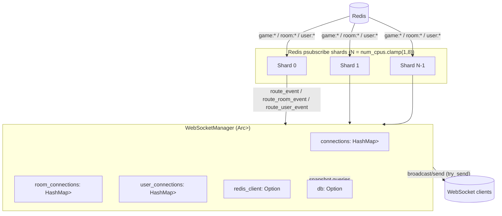

`WebSocketManager` keeps three in-memory connection maps keyed by entity id, an
optional `RedisClient` (pub/sub), and an optional DB handle (snapshots). It is
constructed in `bootstrap.rs` as `WebSocketManager::new(redis_client, Some(db))`.

### 6.2 Connection Lifecycle

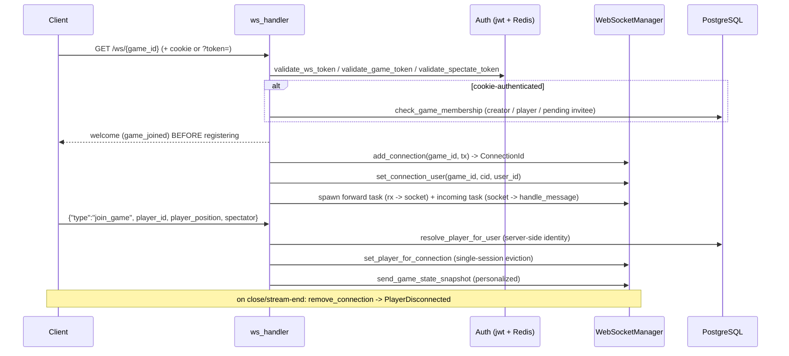

1. **Upgrade** — Actix Web upgrades the request to an `actix_ws` session.
2. **Auth** — cookie `Authorization` JWT (blacklist check) or one-time
   `?token=` (game token, then spectate token). See section 6.3.
3. **Membership** — cookie-auth connections must belong to the game (creator,
   accepted player, or pending invitee); anonymous/spectator are exempt.
4. **Welcome** — `game_joined` (or `room_joined`/`user_joined`) is sent *before*
   registration, so a failed send never registers a dead connection.
5. **Register** — `add_connection` inserts a `TrackedConnection` with a bounded
   `mpsc` sender and records the authenticated identity.
6. **Forward task** — drains the per-connection queue to the socket; on send
   failure it `force_disconnect`s; on channel close it closes the sink so the
   client's `onclose` fires and it can reconnect.
7. **Incoming task** — parses `IncomingMessage` (or protocol Ping/Pong/Close).
8. **Cleanup** — on stream end, `remove_connection` evicts the connection and
   publishes `PlayerDisconnected`.

### 6.3 Authentication & Tokens

| Token | Purpose | Redis key | Validator |
|-------|---------|-----------|-----------|
| Cookie JWT (`Authorization`) | authenticated user | `token:blacklist:{jti}` (revocation) | `validate_ws_token` |
| One-time game token (`?token=`) | anonymous player | `ws_token:{game_id}:{jti}` | `validate_game_token` |
| Spectate token (`?token=`) | read-only stream view | `spectate_token:{game_id}:{jti}` | `validate_spectate_token` |

- Game/spectate tokens are **not** consumed on use — they persist for their TTL
  so anonymous users can reconnect after transient disconnections.
- Anonymous and spectator identities are *deterministic* UUIDs derived from the
  game id (`derive_anonymous_id`, `derive_spectate_id` in `websocket/auth.rs`).
- All Redis lookups **fail-open**: JWT signature/expiry are already validated;
  Redis is only an additional revocation/single-use check.

### 6.4 Client -> Server Messages

`IncomingMessage` (`websocket/messages.rs`), tagged by `"type"`:

| Message | Fields | Effect |
|---------|--------|--------|
| `ping` | - | refresh `last_activity` + `last_pong`; reply `pong` |
| `join_game` | `game_id, player_id?, player_position?, spectator?` | resolve identity, snapshot, single-session eviction |
| `leave_game` | - | no-op (cleanup handled on close) |

Plus protocol-level frames: `Ping` -> `pong`, `Pong` -> `update_pong`,
`Close` -> cleanup. Legacy `{"command":"ping"}` is still accepted as fallback.

### 6.5 Server -> Client Messages

Welcome messages (sent before registration):

- `game_joined {game_id}` (game endpoint)
- `room_joined {room_id}` (room endpoint)
- `user_joined {user_id}` (user endpoint)

`OutgoingMessage` (`websocket/messages.rs`):

| Message | Kind | Recipient |
|---------|------|-----------|
| `game_joined {game_id}` | Control | the connecting client |
| `game_state_snapshot {...}` | Snapshot | a single player / all spectators (personalized, rotated seats) |
| `pong` | Control | replying client |
| `error {message, source}` | Control | a game / player |

Forwarded domain events (`GameEvent` / `RoomEvent` / `UserEvent`, section 6.6)
are routed and delivered as `Control` messages.

### 6.6 Redis Pub/Sub & Event Catalog

Channels follow `{prefix}:{id}`:

| Channel | Event enum | Routed by |
|---------|-----------|-----------|
| `game:{game_id}` | `GameEvent` (19 variants) | `route_event` |
| `room:{room_id}` | `RoomEvent` (5 variants) | `route_room_event` |
| `user:{user_id}` | `UserEvent` (2 variants) | `route_user_event` |

`GameEvent` variants: `card_played`, `round_completed`, `game_finished`,
`turn_changed`, `player_joined`, `game_cancelled`, `game_ready`, `cards_dealt`,
`game_started`, `player_disconnected`, `player_reconnected`, `staleness_warning`,
`player_kicked`, `game_reshuffled`, `player_forfeit_win`, `claim_pending`,
`claim_offered`, `claim_resolved`, `special_claim`.

`RoomEvent` variants: `member_joined`, `member_left`, `run_created`,
`game_started`, `run_completed`.

`UserEvent` variants: `invite_received`, `invite_removed`.

Personalization in `route_event` (`manager/redis.rs`):

| Event | Delivery |
|-------|----------|
| `cards_dealt` | private - only the target player |
| `claim_offered` | private - only the target player |
| `game_started` | personalized - per player with rotated `display_position`; spectators + unidentified get the non-rotated event |
| `player_kicked` | broadcast + evict the player's connections + resend snapshots |
| everything else | broadcast to all game connections |

**Publish side** (`jambo-domain/src/messaging/redis.rs`): `GameService` /
`RoomService` call `publish_*_event_with_retry`, which retries with exponential
backoff and, on exhaustion, buffers the event in a bounded queue
(`buffer_max_size`) flushed by a background task every `flush_interval_secs`.

### 6.7 Sharding

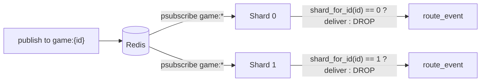

- `shard_for_id(id, N)` hashes the UUID bytes (`hash = hash*31 + byte`, `% N`) -
  deterministic and stable across processes (`websocket/routing.rs`).
- `N = num_cpus::get().clamp(1, 8)`.
- **Every** shard `psubscribe`s all three patterns (`game:*`, `room:*`,
  `user:*`), then drops any event whose `shard_for_id(id) != shard` so each
  entity id is handled by exactly one shard.
- On subscribe failure/disconnect, a shard retries with capped exponential
  backoff (`1s..30s`).

### 6.8 Backpressure

Each connection has a bounded send queue (`WS_SEND_QUEUE_CAPACITY = 256`). On a
full queue:

| MessageKind | Policy |
|-------------|--------|
| `Snapshot` (idempotent, e.g. `game_state_snapshot`) | drop - the next snapshot supersedes it |
| `Control` (stateful, e.g. `game_started`, `player_kicked`) | treat as dead client -> `force_disconnect` |

`deliver()` uses non-blocking `try_send` outside the state lock, serializes each
broadcast once (`Arc<str>`), and returns the slow-consumer ids to disconnect.

### 6.9 Heartbeat & Cleanup

- Application-level `ping`/`pong` refreshes both `last_activity` and
  `last_pong`.
- Protocol-level `Pong` refreshes `last_pong` (the server never initiates pings).
- `start_connection_cleanup_task(5 min, 10 min idle, heartbeat_timeout)` sweeps
  all three maps, evicts connections idle too long or missing pongs, and
  publishes `PlayerDisconnected` for expired player connections.

### 6.10 Disconnection & Reconnection in Games

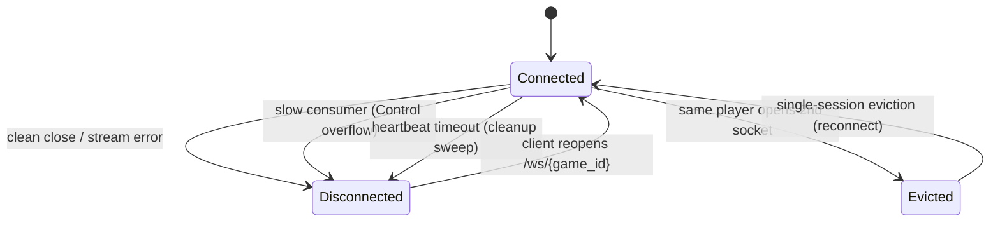

**Disconnect** - three paths all end in `remove_connection`, which decrements
`WS_CONNECTIONS_ACTIVE`, publishes `PlayerDisconnected`, and (if the map empties)
removes the game entry:

1. Clean close / stream error (`ws_handler` incoming task).
2. Slow consumer: a `Control` message hit a full queue -> `force_disconnect`.
3. Heartbeat timeout: cleanup sweep evicts stale/idle connections.

**Reconnect** - the client reopens `GET /ws/{game_id}`:

1. `join_game` resolves the player identity **server-side**
   (`resolve_player_for_user`) so a client cannot spoof another player's
   id/position.
2. `set_player_for_connection` detects a prior connection for the same player or
   authenticated user and **evicts** it (single live socket per player), then
   broadcasts `PlayerReconnected`.
3. The server sends a personalized `game_state_snapshot` (rotated seats,
   private hand) to the rejoining player.
4. Anonymous game tokens persist for their TTL, so anonymous players can
   reconnect after transient disconnections.

**Game-domain staleness -> kick** (scheduler, independent of the socket):

- `check_human_staleness` (`recovery.rs`): a human whose game `updated_at` is
  older than `game_human_staleness_alert_secs` (900s) gets a `StalenessWarning`
  event + email; past `game_human_staleness_kick_secs` (1800s) they are
  `kick_player_from_game`'d -> `PlayerKicked`.
- `detect_and_recover_stalled_games`: stalled bot games (60s) are resumed via
  `BotScheduler::run_sync_chain`.

### 6.11 Spectators

- `join_game {spectator: true}` -> `mark_spectator_for_connection` (clears any
  player identity so a spectator never receives personalized events).
- Spectators get a **public-only** snapshot: fixed seat orientation, no rotated
  `display_position`, `claim_offered_to_position` instead of
  `claim_offered_to_me`, and no `special_cards`.
- `start_spectator_resync_task(interval)` periodically resends the public
  snapshot to every game with spectators - self-healing any pub/sub gap, since
  snapshots are authoritative full state.

---

## 7. AI Worker Mechanisms

### 7.1 Architecture

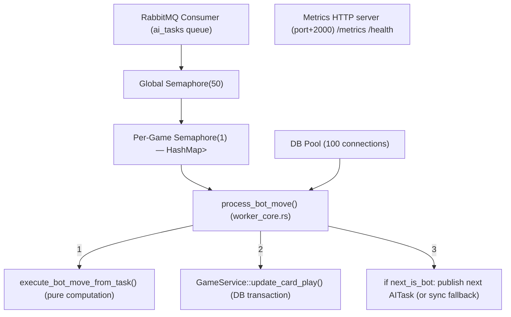

### 7.2 Concurrency Control

| Mechanism | Limit | Purpose |
|-----------|-------|---------|
| `Global Semaphore(50)` | 50 total concurrent bot moves | Prevents overwhelming DB pool |
| `Per-Game Semaphore(1)` | 1 bot move per game at a time | Prevents race conditions within a game |
| `DB Pool (100)` | 100 connections | 2× global semaphore to prevent pool exhaustion |

### 7.3 Bot Strategy Selection

6 strategy variants; `random_high()` selects among 4 (`LongUp`/`LongDown`/`MidUp`/`MidDown`), re-picked per move (`ShortUp`/`ShortDown` are unused):

| Strategy | Playstyle | Zone |
|----------|-----------|------|
| `LongUp` | Plays highest‑ranked cards first | Top half, ascending |
| `LongDown` | Plays highest‑ranked cards first (zone 3 → 1 → 2) | Bottom half, descending |
| `MidUp` | Plays middle‑ranked cards first | Middle, ascending |
| `MidDown` | Plays middle‑ranked cards first | Middle, descending |
| `ShortUp` | Alternates high/low | Narrow band, ascending |
| `ShortDown` | Alternates high/low | Narrow band, descending |

### 7.4 AITask Structure

```rust
struct AITask {
    game_id: Uuid,
    player_id: Uuid,
    correlation_id: Option<Uuid>,
    current_round: i32,
    current_roll: i32,                  // current round number (1-5)
    game_status: String,
    current_player_turn: Option<Uuid>,
    played_cards_this_round: Vec<i32>,  // played card indices this round
    bot_hand_cards: Vec<i32>,           // bot's unplayed cards
    players: Vec<PlayerInfo>,           // all players
    current_winning_card: Option<i32>,
    winning_player_position: Option<i32>,
    bet: i32,
    auto_mode: bool,
}
```

The `AITask` carries enough state for `execute_bot_move_from_task()` to compute the bot's move without any database queries, making AI worker processing extremely fast (< 5ms compute time).

### 7.5 Graceful Shutdown

On Ctrl‑C (SIGINT):
1. Stop accepting new messages from RabbitMQ.
2. Wait for all in‑flight tasks to complete (drain `Semaphore`).
3. Drop the worker (releases the DB pool).
4. Exit.

### 7.6 Queue Depth Monitoring

Every 10 seconds (`AI_WORKER_QUEUE_DEPTH_INTERVAL_SECS`), the worker logs queue statistics:
- **Warning** at 500+ messages queued
- **Critical** at 1000+ messages queued
- Exported as `rabbitmq_queue_length` gauge

---

## 8. Scheduler Worker Mechanisms

### 8.1 Architecture

The `scheduler-worker` binary runs 7 periodic tasks via `tokio::task::JoinSet`, all governed by a `watch` channel for graceful shutdown.

```mermaid
flowchart TD
  S["scheduler-worker binary"] --> JS["tokio::task::JoinSet (7 tasks)"]
  SH["watch::Receiver<bool> shutdown signal"] --> JS
  JS --> T1["cancel_expired_games (30s / 15s)"]
  JS --> T2["detect_stalled_games (max(60s, staleness) / 30s) — also runs check_human_staleness"]
  JS --> T3["check_expired_freezes (60s / 30s)"]
  JS --> T4["refresh_leaderboard (5 min / 60s)"]
  JS --> T5["db_pool_metrics (configurable)"]
  JS --> T6["check_stalled_runs (120s / 30s)"]
  JS --> T7["check_cashout_auto_reject (60s / 30s)"]
```

### 8.2 Task Details

| # | Task | Interval | Timeout | Description |
|---|------|----------|---------|-------------|
| 1 | `cancel_expired_games` | 30s | 15s | Cancels multiplayer `pending` games whose `invite_expires_at` has passed; refunds bets |
| 2 | `detect_stalled_games` | `max(60s, staleness)` | 30s | Finds active games with no card play in `game_staleness_threshold_secs`; auto-plays bot moves to recover. Also runs `check_human_staleness` (warning at alert threshold, kick at kick threshold) |
| 3 | `check_expired_freezes` | 60s | 30s | Finds players with `frozen_until` in the past; unfreezes them, sends email notification |
| 4 | `refresh_leaderboard` | 5 min | 60s | Queries `player_profiles`, rebuilds Redis sorted sets (`leaderboard:wins`, `leaderboard:streak`) |
| 5 | `db_pool_metrics` | configurable | — | Reports `db_pool_size`, `db_pool_idle`, `db_pool_active` to Prometheus |
| 6 | `check_stalled_runs` | 120s | 30s | Finds game runs whose `next_game_auto_start_at` is in the past but no game is active; auto-cancels the run |
| 7 | `check_cashout_auto_reject` | 60s | 30s | Auto-rejects expired cashout requests and notifies user + admin |

### 8.3 Staleness Recovery Flow

```mermaid
flowchart TD
  A["scheduler tick"] --> B["detect_stalled_games() — query active games, updated_at < now - staleness_threshold"]
  B --> C{"current turn?"}
  C -->|"human"| D["check_human_staleness() — warn at alert threshold, kick at kick threshold"]
  C -->|"bot"| E["auto-play bot move: process_bot_move() — recover round, advance game"]
```

---

## 9. Frontend Components & Wirings

### 9.1 Component Tree

```mermaid
flowchart TD
  App["App.tsx"]
  App --> Auth["AuthModal.tsx"]
  App --> Lang["LanguageSwitcher.tsx"]
  App --> Toast["Toast.tsx"]
  App --> Footer["Footer.tsx"]
  App --> Contact["ContactForm.tsx"]
  App --> Reset["PasswordReset.tsx"]
  App --> Anon["Anonymous Dashboard — QuickGameButton → useGameStore"]
  App --> Game["Game View"]
  App --> Dash["User Dashboard (authenticated)"]
  App --> Legal["LegalMentions.tsx"]

  Game --> Table["GameTable.tsx (4-player N/S/E/W)"]
  Table --> Slot["PlayerSlot.tsx × 4"]
  Slot --> Fan["CardFan.tsx"]
  Table --> Card["Card.tsx (suit color, rank number)"]
  Game --> Deck["DeckSlots.tsx"]
  Game --> Ring["WinnerRing.tsx"]
  Game --> Over["GameOverModal.tsx"]
  Game --> Lobby["GameLobby.tsx"]

  Dash --> UD["UserDashboard.tsx"]
  Dash --> Rules["GameRules.tsx"]
  Dash --> Leader["LeaderboardPanel.tsx"]
  Dash --> RoomMgmt["Room Management"]
  RoomMgmt --> RD["RoomDashboard.tsx"]
  RoomMgmt --> RL["RoomList.tsx"]
  RoomMgmt --> CRM["CreateRoomModal.tsx"]
  RoomMgmt --> JR["JoinRoomForm.tsx"]
  RoomMgmt --> CRun["CreateRunModal.tsx"]
  RoomMgmt --> GRP["GameRunPanel.tsx"]
  Dash --> Pay["Payment"]
  Pay --> Unfreeze["UnfreezePage (PayPal)"]
  Pay --> Topup["TopupPage (PayPal)"]
```

### 9.2 Zustand Stores

#### `useGameStore` — Game State

```typescript
interface GameState {
  gameId: string | null;
  players: Player[];            // {id, type, name, position, display_position, cards[], cards_count?}
  status: string;               // "pending" | "active" | "finished" | "kora" | "double_kora"
  currentTurn: number;          // display_position of current player
  bet: number;
  deckSlots: (number | null)[]; // played cards in centre
  remainingCards: Record<string, number>; // cards left per player
  roundWinner: RoundWinner | null;
  gameOver: GameOverData | null;

  // Actions
  setGame(id, players, status, turn, bet, deckSlots?): void;
  resetGame(): void;
  applyCardPlayed(playerId, cardIndex, nextTurn?): void;
  setRoundWinner(winner): void;
  clearRoundWinner(): void;
  setDeckSlots(slots): void;
  clearDeckSlots(): void;
  setGameOver(data): void;
}
```

#### `useAuthStore` — Authentication

```typescript
interface AuthState {
  user: AuthenticatedUser | null;
  isAuthenticated: boolean;
  token: string | null;
  login(email, password): Promise<void>;
  register(pseudo, email, password): Promise<void>;
  logout(): Promise<void>;
  fetchMe(): Promise<void>;
}
```

#### `useLanguageStore` — i18n Sync

```typescript
interface LanguageState {
  language: 'en' | 'fr';
  setLanguage(lang): Promise<void>;   // also calls POST /api/lang
  fetchLanguage(): Promise<void>;
}
```

#### `useRoomStore` — Room Management

```typescript
interface RoomState {
  currentRoom: Room | null;
  currentRun: GameRun | null;
  rooms: Room[];
  setCurrentRoom(room): void;
  setCurrentRun(run): void;
  fetchRooms(): Promise<void>;
}
```

### 9.3 Hooks & WebSocket Wiring

```mermaid
flowchart TD
  UWS["useWebSocket.ts (low-level)"] --> Mgr["Singleton WebSocketManager per gameId/roomId — auto-reconnect, pub/sub, JSON parsing, ping/pong"]
  UWS --> GameWS["useGameWebSocket.ts (game events)"]
  UWS --> RoomWS["useRoomWebSocket.ts (room events)"]

  GameWS -->|card_played| G1["useGameStore.applyCardPlayed()"]
  GameWS -->|round_completed| G2["useGameStore.setRoundWinner() + clearDeckSlots()"]
  GameWS -->|game_finished| G3["useGameStore.setGameOver()"]
  GameWS -->|turn_changed| G4["useGameStore.setCurrentTurn()"]
  GameWS -->|game_started| G5["useGameStore.setGame()"]
  GameWS -->|cards_dealt| G6["useGameStore.updatePlayerCards()"]
  GameWS -->|player_kicked| G7["useGameStore (reshuffle)"]
  GameWS -->|staleness_warning| G8["Toast"]

  RoomWS -->|member_joined / member_left / run_created / run_completed| R1["useRoomStore update"]
  RoomWS -->|game_started| R2["navigate to game"]
```

### 9.4 Data Flow: User Clicks Card

```
1. User clicks Card.tsx
2. onClick → CardFan.tsx / PlayerSlot.tsx
3. axios.post('/api/games/{gameId}/play', { player_id, card_index },
              { headers: { 'X-Idempotency-Key': crypto.randomUUID() } })
4. Backend processes (see §2.3 sequence diagram)
5. Response 200 OK → frontend updates optimistically
6. WebSocket delivers CardPlayed event → useGameStore.applyCardPlayed()
7. React re-renders: card removed from hand, deck slot filled, turn indicator moves
8. If bot plays next:
   a. WebSocket delivers CardPlayed for bot
   b. Frontend sees another player's card appear in deck slot
   c. Chain continues until human's turn
9. When round completes:
   a. useGameWebSocket receives round_completed
   b. DeckSlots cleared, WinnerRing animates, turn advances
10. When game ends:
    a. useGameWebSocket receives game_finished
    b. GameOverModal appears
```

---

## 10. Game Service Layer

The game domain exposes a trait-based facade
(`jambo-domain/src/game/service/types.rs`). A single `GameService` struct
implements four narrowly-scoped service traits that together compose
`GameServiceTrait`.

```mermaid
flowchart TD
  GS["GameService (jambo-domain/src/game/service)"] --> Gp["GamePlayService"]
  GS --> Inv["InviteService"]
  GS --> Lc["GameLifecycleService"]
  GS --> Bn["BenchmarkService"]
  Gp --> T["GameServiceTrait"]
  Inv --> T
  Lc --> T
  Bn --> T
```

### 10.1 Role

API handlers never touch repositories or `GameService` internals directly. They
receive `web::Data<Arc<dyn GamePlayService>>` (etc.) injected at bootstrap
(`jambo-server/src/bootstrap.rs`) and call the trait methods.

### 10.2 Operations

| Trait | Method | Purpose |
|-------|--------|---------|
| `GamePlayService` | `play_card(game_id, player_id, card_index, correlation_id, idempotency_key)` | Validate + persist card play, evaluate round, publish events, schedule bot |
| `GamePlayService` | `advance_bot(game_id, human_player_id)` | Advance a bot move synchronously |
| `GamePlayService` | `evaluate_round(game_id, human_player_id, idempotency_key)` | Evaluate the current round |
| `GamePlayService` | `verify_player_ownership(game_id, player_id, user_id)` | Check a user owns a player |
| `GamePlayService` | `claim_special_victory(...)` / `decline_special_claim(...)` | Resolve special-card claims |
| `InviteService` | `send_invites(game_id, creator_user_id, invited_user_ids)` | Insert invites, send emails, publish `InviteReceived` |
| `InviteService` | `accept_invite(game_id, user_id, pseudo)` / `decline_invite(game_id, user_id)` | Accept/decline a multiplayer invite |
| `GameLifecycleService` | `create_quick_game(...)` / `create_quick_game_for_user_with_step_by_step(...)` | Create a solo quick game |
| `GameLifecycleService` | `create_multiplayer_game(user_id, pseudo, bet, max_players)` | Create a pending multiplayer game |
| `GameLifecycleService` | `start_game(game_id, user_id)` | Start a multiplayer game |
| `BenchmarkService` | `create_benchmark_multiplayer_game(...)` / `cleanup_benchmark_data()` | Benchmark-mode helpers |

### 10.3 Idempotency Implementation

```mermaid
flowchart TD
  A["play_card(player_id, card_index, maybe_idempotency_key)"] --> B{"key exists?"}
  B -->|No| Z["skip idempotency"]
  B -->|Yes| C["Redis SET NX EX idem:{player_id}:{key} = 'pending' 300s"]
  C -->|"OK (key didn't exist)"| D["proceed with play"]
  D -->|"play succeeds"| E["SET idem:... = 'ok:{outcome_json}' EX 300"]
  D -->|"play fails"| F["DEL idem:..."]
  C -->|"FAIL (key exists)"| G["GET idem:..."]
  G -->|"'pending'"| H["return GameError::IdempotencyInProgress"]
  G -->|"'ok:{...}'"| I["return cached outcome"]
  G -->|"else"| J["proceed normally (stale entry)"]
```

### 10.4 Trait Abstraction & Testing

```rust
#[async_trait]
pub trait GameServiceTrait:
    GamePlayService + InviteService + GameLifecycleService + BenchmarkService
{
}
```

A `mock` module (`#[cfg(any(test, feature = "testing"))] pub mod mock`) provides
in-memory implementations of the service traits for integration tests.

---

## 11. Cache Mechanisms

### 11.1 Cache Layers Overview

```mermaid
flowchart TD
  subgraph redis["Redis (optional)"]
    UC["UserCache — user:uuid:{uuid} / user:pseudo:{name} (TTL 15 min)"]
    GC["GameState Cache — game:state:{game_id} (TTL 5 min)"]
    LB["Leaderboard — leaderboard:wins / leaderboard:streak sorted sets (refresh 5 min)"]
    DC["Dashboard Cache — dashboard:profile:{user_id} (5 min) / dashboard:games:{user_id}:* (30 s)"]
    IC["Idempotency Cache — idem:{player_id}:{key} (TTL 300 s)"]
    RC["Rate Limiter Cache — ratelimit:{path}:{user_id} (TTL window_seconds)"]
  end
```

### 11.2 UserCache

**Purpose**: Avoid repeated DB queries to resolve user UUIDs to pseudos and emails.

**Insertion**: On user creation, profile update, or bulk population (startup warm‑up).

```
PUT user:uuid:{uuid}  = {pseudo: "...", email: "..."}  EX 900
PUT user:pseudo:{name} = {uuid}                         EX 900
```

**Fetching**:

| Method | Pattern | Redis Command |
|--------|---------|---------------|
| By UUID | `user:uuid:{uuid}` | `GET` |
| By pseudo | `user:pseudo:{pseudo}` → `user:uuid:{uuid}` | `GET` + `GET` |
| Bulk | `user:uuid:{*}` | `MGET` (pipeline) |

**Fallback**: If Redis unavailable → returns `None` → caller falls back to DB query.

**Invalidation**: On user update/delete → `DEL user:uuid:{uuid}` + `DEL user:pseudo:{pseudo}`.

### 11.3 GameState Cache

**Purpose**: Reduce DB queries for read‑heavy game state lookups (dashboard, `/me` endpoints).

**Insertion**: After each successful card play (if game still active):
```
SETEX game:state:{game_id} {cached_game_state_json} 300
```

**Fetching**:
- `GET game:state:{game_id}` → `GameCache::get_game_state()`
- Cache hit → return directly (no DB query)
- Cache miss → query DB, optionally populate cache

**Invalidation**:
- Game finishes → `DEL game:state:{game_id}` (explicit)
- Game is cancelled → `DEL game:state:{game_id}` (explicit)
- TTL expiry → auto‑cleaned by Redis after 5 min

**Cache staleness mitigation**: TTL is short (5 min) and the cache is invalidated on every significant game state change.

### 11.4 Leaderboard Cache

**Purpose**: Fast global leaderboard queries without sorting the entire `player_profiles` table.

**Data structure**: Redis Sorted Sets.

```
ZADD leaderboard:wins {score} {user_id}
ZADD leaderboard:streak {score} {user_id}
```

**Refresh**: Every 5 minutes by scheduler task `refresh_leaderboard`:
1. Query `SELECT user_id, wins, winning_streak FROM player_profiles`.
2. `ZADD` all entries (overwrites existing scores).
3. Sets are always consistent with DB state.

**Fetching**: `ZREVRANGE leaderboard:wins 0 9 WITHSCORES` → top 10.

**Fallback**: If Redis unavailable → DB query with `ORDER BY wins DESC LIMIT 10`.

### 11.5 Dashboard Cache

**Purpose**: Reduce repeated authenticated dashboard loads.

**Insertion**: On dashboard load (`GET /api/me/profile`, `GET /api/me/games`):
```
SETEX dashboard:profile:{user_id} {profile_json} 300
SETEX dashboard:games:{user_id}:{page} {games_json} 30
```

**Invalidation**: On game completion, cancellation, profile update → `DEL dashboard:*:{user_id}:*` (pattern delete: `SCAN` + `DEL`).

**Fallback**: Cache miss → DB query → populate cache → return.

### 11.6 Idempotency Cache

**Purpose**: Prevent duplicate card plays from retried HTTP requests.

```
SET NX EX idem:{player_id}:{key} "pending" 300
  → success: proceed with play, then SET "ok:{outcome}"
  → failure: GET key → if "pending" return 409, if "ok:..." return cached 200
```

**TTL**: 300s (5 min) — long enough to cover any reasonable retry window.

### 11.7 Rate Limiter Cache

**Purpose**: Sliding window rate limiting per endpoint per user/IP.

**Storage**: Per‑endpoint Redis keys:
```
ratelimit:{path}:{user_id}  → counter
```

**Algorithm**:
1. `INCR ratelimit:register:{user_ip}`
2. If `== 1`, `EXPIRE ratelimit:register:{user_ip} {window_seconds}`
3. If `> max_requests`, reject with 429.

**Fallback**: If Redis unavailable → local in‑memory limiter (per instance, eventually‑consistent).

---

## 12. Scalability Mechanisms

### 12.1 WebSocket Subscriber Sharding

**Problem**: A single `psubscribe` task handling all `game:*` events would be a bottleneck under load (serial JSON deserialization + routing).

**Solution**: N = `num_cpus::get().clamp(1, 8)` parallel subscriber tasks, each subscribing to `game:*`, `room:*` and `user:*`. A deterministic hash (`hash(id_bytes) % N`, `websocket/routing.rs`) assigns each game/room/user id to exactly one shard.

**Benefit**: ~N× throughput increase for event distribution.

**Limitation**: True cross‑instance WebSocket delivery requires Redis Cluster or an external message bus; currently the system runs as a single backend instance.

### 12.2 Non‑Blocking Synchronization

**Problem**: Original code used `std::sync::Mutex` (blocking) inside async contexts, risking thread pool exhaustion.

**Solution**: Replaced all blocking mutexes with `tokio::sync::Mutex` (async‑aware). Metrics counters use `AtomicU64` for lock‑free updates.

### 12.3 Optimistic Locking with Retry

**Problem**: Concurrent card plays on the same game (human + bot arriving simultaneously) could cause lost updates.

**Solution**: `Game::updated_at` column serves as a version. `GameService::update_card_play()`:
```
loop retry ≤ 3:
  UPDATE games SET ... WHERE id = $1 AND updated_at = $2
  if rows_affected == 0:
    sleep(backoff: 20ms, 40ms)
    re-read game state
    retry
  else:
    break
```

This eliminates the need for row‑level locks in PostgreSQL while preserving correctness.

### 12.4 Bot Chain Throttling

**Problem**: In sync fallback mode, a single game's bot chain could iteratively process all 3 bot moves serially, consuming a DB connection for an extended period.

**Solution**: Global `Semaphore(10)` limits the number of concurrent sync chains. If all 10 slots are occupied, additional games wait asynchronously without blocking threads.

### 12.5 DB Pool Decoupling

**Problem**: AI worker and HTTP server share the same DB pool; if AI worker consumes all connections, HTTP requests would hang.

**Solution**: The AI worker runs as a separate binary with its own DB pool (100 connections, decoupled from the HTTP server's pool). The global semaphore(50) ensures at most 50 concurrent worker tasks, leaving 50 connections for overhead + maintenance.

### 12.6 Connection Pool Configuration

```rust
db_pool_max_connections: u32,         // default 100 (server & scheduler); AI worker uses AI_WORKER_DB_POOL_SIZE (default 100)
db_pool_min_connections: u32,         // keep warm
db_pool_connect_timeout_secs: u64,    // fail fast on startup
db_pool_acquire_timeout_secs: u64,    // propagate contention errors
db_pool_idle_timeout_secs: u64,       // release idle connections
db_pool_max_lifetime_secs: u64,       // prevent stale connections
```

### 12.7 Decorrelated AI Worker Instances

Multiple `ai-worker` processes can be deployed behind a single RabbitMQ queue. RabbitMQ's round‑robin dispatch distributes tasks across workers. The per‑game mutex (in‑memory) ensures that two workers don't process the same game simultaneously (though at most one task per game is in‑flight at a time since tasks are serialized by the game engine).

---

## 13. Fallback Mechanisms

### 13.1 Fallback Matrix

| Component | Primary Path | Fallback | Trigger Condition |
|-----------|-------------|----------|-------------------|
| **Bot scheduling** | RabbitMQ `ai_tasks` queue | `BotScheduler::run_sync_chain()` | RabbitMQ unavailable OR publish fails |
| **AI task construction** | `build_ai_task()` (full state) | `AITask::minimal()` (no state) | `build_ai_task()` fails (e.g., DB error) |
| **Bot move computation** | `execute_bot_move_from_task()` (pure) | `execute_bot_move()` (DB query) | Task data insufficient |
| **Sync chain dispatch** | Direct `update_card_play()` call | `Semaphore(10)` gated queue | Normal operation (throttling) |
| **Redis event publish** | `publish()` to channel | Event silently dropped (logged) | Redis unavailable |
| **WebSocket broadcast** | Redis Pub/Sub → all instances | In‑memory only (single instance) | Redis subscriber unavailable |
| **Game cache fetch** | Redis `GET game:state:{id}` | DB query | Cache miss or Redis unavailable |
| **Game cache invalidation** | Redis `DEL` + `SCAN` `DEL` | Returns 0 (cache TTL will clean) | Redis unavailable |
| **User cache** | Redis `GET` / `MGET` | Returns `None` → DB fallback | Redis unavailable |
| **Idempotency** | Redis `SET NX EX` | Skip idempotency (log warning) | Redis unavailable |
| **Rate limiting** | Redis `INCR` + `EXPIRE` | Local in‑memory counter | Redis unavailable |
| **Optimistic lock** | Retry with backoff (20/40ms) | Return `GameError::internal("Optimistic lock conflict after max retries")` | retries exhausted |
| **Circuit breaker** | Normal publish | `open`: skip publish, `half-open`: probe publish | 5 consecutive RabbitMQ failures |
| **Leaderboard fetch** | `ZREVRANGE leaderboard:wins` | `SELECT ... ORDER BY wins DESC LIMIT 10` | Redis unavailable |
| **API 404** | Route matched | `fallback::not_found()` JSON with `request_id` | No route matched |
| **API 405** | Route matched | `fallback::method_not_allowed()` JSON with `request_id` | Method not supported |

### 13.2 Circuit Breaker State Machine

```mermaid
stateDiagram-v2
  [*] --> CLOSED
  CLOSED --> OPEN : failure_count >= threshold (5)
  OPEN --> HALF_OPEN : cooldown expires (30s)
  HALF_OPEN --> CLOSED : probe succeeds
  HALF_OPEN --> OPEN : probe fails
```

- **Threshold**: 5 consecutive failures (`circuit_breaker_failure_threshold`)
- **Cooldown**: 30s (`circuit_breaker_cooldown_secs`)
- **Exported as gauge**: `circuit_breaker_state` (0=closed, 1=open, 2=half-open)

### 13.3 Sync Chain Fallback Flow

```mermaid
flowchart TD
  A["BotScheduler::schedule_if_next_bot(next_player)"] --> B{"next player?"}
  B -->|"HUMAN"| Z["return (nothing to do)"]
  B -->|"BOT"| C["build_ai_task()"]
  C -->|"succeeds"| D["publish to RabbitMQ"]
  D -->|"succeeds"| R["return"]
  D -->|"fails"| F["run_sync_chain(game_id)"]
  C -->|"fails"| F
  F --> G["acquire Semaphore(10) permit"]
  G --> H["read game state from DB"]
  H --> I["execute_one_bot_move() → update_card_play()"]
  I --> J{"next player also BOT?"}
  J -->|"yes"| I
  J -->|"no"| K["release permit, return"]
```

### 13.4 Graceful Degradation Without Redis

When Redis is completely unavailable:

| Capability | Status |
|-----------|--------|
| HTTP API | Fully functional (all CRUD operations) |
| WebSocket events | In‑memory only (works for single‑instance) |
| Cross‑instance WS | Broken (requires Redis Pub/Sub) |
| Rate limiting | Local in‑memory fallback (per‑instance) |
| Leaderboard | Direct DB query |
| User cache | Direct DB query |
| Game state cache | Direct DB query |
| Idempotency | Disabled (warning logged) |
| Performance | Degraded (more DB queries) |

---

## 14. Metrics

### 14.1 Prometheus Metric Families

#### RabbitMQ

| Metric | Type | Labels |
|--------|------|--------|
| `rabbitmq_publish_total` | CounterVec | `queue` |
| `rabbitmq_publish_errors_total` | CounterVec | `queue` |
| `rabbitmq_consume_total` | Counter | — |
| `rabbitmq_healthy` | Gauge | — |
| `rabbitmq_queue_length` | Gauge | — |

#### WebSocket

| Metric | Type | Labels |
|--------|------|--------|
| `ws_messages_sent_total` | Counter | — |
| `ws_messages_dropped_total` | Counter | — |
| `ws_connections_active` | Gauge | — |
| `ws_disconnects_total` | Counter | — |
| `ws_heartbeat_timeouts_total` | Counter | — |
| `ws_spectators_per_game` | GaugeVec | `game_id` |
| `ws_send_failed_total` | Counter | — |
| `ws_slow_consumer_disconnects_total` | Counter | — |
| `ws_send_queue_depth` | Gauge | — |
| `ws_auth_blacklist_redis_errors_total` | Counter | — |
| `ws_token_validation_redis_errors_total` | Counter | — |

#### HTTP

| Metric | Type | Labels |
|--------|------|--------|
| `http_requests_total` | CounterVec | `method, path, status` |
| `http_request_duration_seconds` | HistogramVec | `method, path` |

#### Game

| Metric | Type | Labels |
|--------|------|--------|
| `games_finished_total` | CounterVec | `status` (finished/kora/double_kora) |
| `active_games` | Gauge | — |
| `game_creation_duration_seconds` | HistogramVec | `game_mode` |
| `game_duration_seconds` | HistogramVec | `game_mode` |
| `card_play_duration_seconds` | HistogramVec | `operation` |
| `round_eval_duration_seconds` | HistogramVec | — |
| `games_stalled_total` | Counter | — |
| `game_state_cache_write_errors_total` | Counter | — |

#### Bot / AI Worker

| Metric | Type | Labels |
|--------|------|--------|
| `ai_task_duration_seconds` | HistogramVec | `execution_method` |
| `ai_tasks_in_flight` | Gauge | — |
| `bot_move_duration_seconds` | HistogramVec | `execution_method` |
| `bot_errors_total` | CounterVec | `error_type` |
| `bot_chain_fallback_total` | Counter | — |
| `bot_chain_publish_failures_total` | Counter | — |
| `bot_chain_retries_total` | Counter | — |
| `bot_chain_breaks_total` | Counter | — |

#### Database

| Metric | Type | Labels |
|--------|------|--------|
| `db_pool_size` | GaugeVec | `process` |
| `db_pool_idle` | GaugeVec | `process` |
| `db_pool_active` | GaugeVec | `process` |
| `db_query_duration_seconds` | HistogramVec | `query_type` |
| `db_transaction_duration_seconds` | HistogramVec | `operation` |

#### Redis

| Metric | Type | Labels |
|--------|------|--------|
| `redis_publish_duration_seconds` | HistogramVec | — |
| `redis_publish_retries_total` | CounterVec | `channel` |
| `redis_publish_failures_total` | CounterVec | `channel` |
| `redis_buffer_overflow_total` | Counter | — |
| `redis_cache_hits_total` | Counter | — |
| `redis_cache_misses_total` | Counter | — |
| `redis_cache_hit_ratio` | Gauge | — |
| `redis_subscriber_shards_active` | Gauge | — |

#### Payment

| Metric | Type | Labels |
|--------|------|--------|
| `payment_topup_total` | CounterVec | `status` |
| `payment_unfreeze_total` | CounterVec | `status` |
| `payment_topup_duration_seconds` | HistogramVec | `operation` |
| `payment_unfreeze_duration_seconds` | HistogramVec | `operation` |

#### Rate Limiting

| Metric | Type | Labels |
|--------|------|--------|
| `rate_limit_hits_total` | Counter | — |

#### Circuit Breaker

| Metric | Type | Labels |
|--------|------|--------|
| `circuit_breaker_state` | Gauge | — |

#### Scheduler

| Metric | Type | Labels |
|--------|------|--------|
| `scheduler_task_duration_seconds` | HistogramVec | `task` |
| `scheduler_task_timeouts_total` | CounterVec | `task` |
| `scheduler_task_errors_total` | CounterVec | `task` |
| `scheduler_last_run_timestamp_seconds` | GaugeVec | `task` |

#### System & Misc

| Metric | Type | Labels |
|--------|------|--------|
| `memory_usage_bytes` | GaugeVec | `process` |
| `cpu_usage_percent` | GaugeVec | `process` |
| `run_completion_errors_total` | Counter | — |
| `email_send_errors_total` | CounterVec | `kind` |

### 14.2 Metrics Endpoint

```
GET /metrics  →  Prometheus text format (Content-Type: text/plain; version=0.0.4)
```

Available on `jambo-server` (`/metrics`), `ai-worker` (own HTTP server on `port + 2000`), and `scheduler-worker` (own HTTP server on `port + 1000`).

---

## 15. Internationalization (i18n)

### 15.1 Architecture

```mermaid
flowchart TD
  A["Language Detection — 1. cookie 'lang', 2. Accept-Language header, 3. default 'en'"] --> B["I18nMiddleware (attaches Lang to request)"]
  B --> C["Translator (en.json / fr.json → HashMap)"]
  C --> D["API Endpoints"]
  D --> D1["POST /api/lang {lang} → Set-Cookie lang"]
  D --> D2["GET /api/lang → {lang}"]
  D --> D3["GET /api/languages → ['en','fr']"]
```

### 15.2 Translation File Structure

`crates/jambo-i18n/src/translations/en.json` and `fr.json` contain ~120 keys organized by domain:

```
auth.*          — Registration, login, logout, password reset
password.*      — Forgot/reset password flows
contact.*       — Contact form messages
game.*          — Game validation errors, status messages
leaderboard.*   — Leaderboard errors
payment.*       — PayPal flow messages
validation.*    — Input validation errors
rate_limit.*    — Rate limit exceeded message
email.subject.* — Email subject lines
paypal_page.*   — PayPal return/cancel page content
websocket.*     — WS command errors
language.*      — Language switching messages
dashboard.*     — Dashboard labels
room.*          — Room management messages
run.*           — Game run messages
```

### 15.3 Frontend i18n

Uses `i18next` + `react-i18next` + `i18next-browser-languagedetector`:
- `useLanguageStore` (Zustand) syncs with backend
- `LanguageSwitcher` component toggles `en`/`fr`
- On language change: calls `POST /api/lang` → backend sets cookie → frontend `i18n.changeLanguage()`
- On auth state change: re‑fetches language from backend

---

## 16. Logging & Debugging

### 16.1 Logging Infrastructure

| Layer | Technology | Configuration |
|-------|-----------|---------------|
| Structured logs | `tracing` + `tracing-subscriber` | JSON format, level from `RUST_LOG` (default `info`) |
| HTTP spans | custom `CorrelationIdMiddleware` | Span per request (`http.method`, `http.path`, `http.status_code`) |
| WebSocket spans | Custom `ws.rs` helpers | Span per connection, per event type |
| Correlation | `CorrelationId` (UUID) | Propagated via task‑local storage |

### 16.2 CorrelationId Propagation

```mermaid
flowchart TD
  A["Frontend (X-Request-Id, fallback X-Correlation-Id header)"] --> B["CorrelationIdMiddleware"]
  B --> C["extract or generate UUID → task-local CORRELATION_ID"]
  B --> D["inject X-Request-Id response header"]
  C --> E["GameService::play_card() → correlation_id in GameEvent"]
  C --> F["Redis publish → correlation_id in event JSON"]
  C --> G["RabbitMQ AITask → correlation_id in task"]
  C --> H["WebSocket outgoing → correlation_id in event JSON"]
```

### 16.3 Log Levels

| Level | Example Events |
|-------|---------------|
| `ERROR` | DB connection failure, RabbitMQ publish failure, bot move error, scheduler task error |
| `WARN` | Redis unavailable (proceeding without), circuit breaker opened, rate limit hit, sync fallback activated, queue depth > 500, optimistic lock retry |
| `INFO` | HTTP request (method, path, status, duration), game created, game finished, player joined, run created, payment captured, scheduler task completed |
| `DEBUG` | Card play details, round evaluation, bot strategy selection, cache hit/miss, idempotency check |
| `TRACE` | Full event JSON payloads, DB query parameters |

### 16.4 Bug Retrieval Strategy

1. **CorrelationId search**: Every log line for a given request shares the same `correlation_id`. Search logs for the `X-Request-Id` returned in the error response to see the full trace.
2. **Prometheus alerts**: Set up alerting on `bot_errors_total`, `rabbitmq_queue_length`, `scheduler_task_errors_total`, `games_stalled_total`, `circuit_breaker_state`.
3. **Structured log queries**: JSON logs enable field‑specific queries: `jq 'select(.fields.game_id == "xxx")'`, `jq 'select(.span.name == "update_card_play")'`.
4. **WebSocket tracing**: Each WS connection has a span; events are child spans. Filter by `connection_id` or `game_id`.
5. **Scheduler task metrics**: `scheduler_last_run_timestamp_seconds` reveals if a task has stopped running (gap > expected interval).
6. **DB pool metrics**: `db_pool_active` approaching `db_pool_max_connections` indicates connection exhaustion.

### 16.5 Span Hierarchy (Example)

```mermaid
flowchart TD
  A["http_request (http.method, http.path, http.status_code, correlation_id)"] --> B["card_play (game_id, player_id)"]
  B --> C["round_eval"]
```

---

## 17. Database Schema

### 17.1 Entity‑Relationship Diagram

```mermaid
erDiagram
  USER ||--o| PLAYER_PROFILE : has
  USER ||--o{ PLAYER : plays
  USER ||--o{ GAME_INVITE : invited
  USER ||--o{ GAME : creates
  USER ||--o{ ROOM : creates
  USER ||--o{ ROOM_MEMBER : member
  USER ||--o{ GAME_RUN : creates
  USER ||--o{ GAME_RUN_PLAYER : joins
  USER ||--o{ CASHOUT_REQUEST : requests
  USER ||--o{ TOPUP_TRANSACTION : transacts

  GAME ||--o{ PLAYER : has
  GAME ||--o{ GAME_CARD : deals
  GAME ||--o{ GAME_INVITE : sends
  GAME ||--o| PLAYER : winner
  GAME ||--o{ GAME_RUN_GAME : in_run

  PLAYER ||--o{ GAME_CARD : holds

  ROOM ||--o{ ROOM_MEMBER : has
  ROOM ||--o{ GAME_RUN : runs

  GAME_RUN ||--o{ GAME_RUN_PLAYER : has
  GAME_RUN ||--o{ GAME_RUN_GAME : includes
  GAME_RUN ||--o{ GAME_RUN_EVENT : logs

  GAME_RUN_GAME ||--o| GAME : references

  USER {
    uuid id PK
    string pseudo
    string email
    string password_hash
    string last_ip_hash
    string language
    datetime created_at
    datetime updated_at
  }
  PLAYER_PROFILE {
    uuid id PK
    uuid user_id FK
    string player_type
    int credit
    int game_played
    int wins
    int kora_wins
    int winning_streak
    float latitude
    float longitude
    string country_code
    string city
    datetime frozen_until
    boolean cashout_locked
    datetime created_at
    datetime updated_at
  }
  GAME {
    uuid id PK
    string status
    int bet
    datetime created_at
    datetime updated_at
    datetime finished_at
    int rank
    int roll
    boolean auto
    uuid winner_id FK
    string player_positions
    int current_winning_card
    int current_winning_player_position
    uuid creator_id FK
    string game_mode
    int max_players
    datetime invite_expires_at
    datetime stall_warning_sent_at
    uuid game_run_id FK
    boolean step_by_step
    string kicked_players
    uuid pending_claim_player_id
  }
  PLAYER {
    uuid id PK
    uuid game_id FK
    string player_type
    string name
    int position
    int credits
    datetime created_at
    uuid user_id FK
    boolean kicked
    datetime kicked_at
  }
  GAME_CARD {
    uuid id PK
    uuid game_id FK
    uuid player_id FK
    int card_index
    boolean played
    datetime played_at
    int round
    datetime created_at
  }
  GAME_INVITE {
    uuid id PK
    uuid game_id FK
    uuid invited_user_id FK
    string status
    datetime created_at
  }
  ROOM {
    uuid id PK
    string name
    uuid creator_id FK
    string invitation_code
    datetime created_at
    datetime updated_at
  }
  ROOM_MEMBER {
    uuid id PK
    uuid room_id FK
    uuid user_id FK
    datetime joined_at
  }
  GAME_RUN {
    uuid id PK
    uuid room_id FK
    int num_games
    int bet_per_game
    int num_players
    int current_game_index
    string status
    uuid created_by FK
    datetime next_game_auto_start_at
    datetime stall_warning_sent_at
    datetime stall_cancelled_at
    datetime created_at
    datetime updated_at
  }
  GAME_RUN_PLAYER {
    uuid id PK
    uuid game_run_id FK
    uuid user_id FK
    int position
    int provisioned_credits
    boolean kicked
    datetime joined_at
  }
  GAME_RUN_GAME {
    uuid id PK
    uuid game_run_id FK
    uuid game_id FK
    int game_index
    string status
    datetime created_at
  }
  GAME_RUN_EVENT {
    uuid id PK
    uuid game_run_id FK
    uuid user_id FK
    string event_type
    string data
    datetime created_at
  }
  ADMIN_KEY {
    uuid id PK
    string label
    string key_hash
    datetime created_at
    datetime revoked_at
  }
  CASHOUT_REQUEST {
    uuid id PK
    uuid user_id FK
    int credits
    int amount_eur_cents
    string status
    string paypal_email
    string paypal_payout_batch_id
    string admin_note
    uuid processed_by
    datetime created_at
    datetime updated_at
    datetime processed_at
  }
  TOPUP_TRANSACTION {
    uuid id PK
    uuid user_id FK
    string kind
    int amount_eur_cents
    int credits
    string order_id
    datetime created_at
  }
```

### 17.2 Enums

| Enum | Values | Used By |
|------|--------|---------|
| `GameStatus` | `pending`, `active`, `finished`, `cancelled`, `kora`, `double_kora`, `ready` | `games.status` |
| `PlayerType` | `human`, `bot` | `players.player_type`, `player_profiles.player_type` |
| `GameMode` | `solo`, `multiplayer` | `games.game_mode` |
| `InviteStatus` | `pending`, `accepted`, `declined` | `game_invites.status` |
| `RunStatus` | `active`, `cancelled`, `completed` | `game_runs.status`, `game_run_games.status` |
| `CashoutStatus` | `requested`, `approved`, `rejected`, `paid` | `cashout_requests.status` |
| `TopupTransactionKind` | `topup`, `unfreeze` | `topup_transactions.kind` |

### 17.3 Key Relationships

- `User` 1:1 `PlayerProfile` (via `user_id`)
- `User` 1:N `Player` (via `user_id`, optional)
- `User` 1:N `Game` (via `creator_id`)
- `User` 1:N `GameInvite` (via `invited_user_id`)
- `User` 1:N `Room` (via `creator_id`)
- `User` 1:N `RoomMember` (via `user_id`)
- `User` 1:N `GameRun` (via `created_by`)
- `User` 1:N `GameRunPlayer` (via `user_id`)
- `User` 1:N `CashoutRequest` (via `user_id`)
- `User` 1:N `TopupTransaction` (via `user_id`)
- `Game` 1:N `Player` (via `game_id`)
- `Game` 1:N `GameCard` (via `game_id`)
- `Game` N:1 `Player` (via `winner_id`)
- `Game` 1:N `GameInvite` (via `game_id`)
- `Game` 1:N `GameRunGame` (via `game_id`)
- `Player` 1:N `GameCard` (via `player_id`, optional)
- `Room` 1:N `RoomMember` (via `room_id`)
- `Room` 1:N `GameRun` (via `room_id`)
- `GameRun` 1:N `GameRunPlayer` (via `game_run_id`)
- `GameRun` 1:N `GameRunGame` (via `game_run_id`)
- `GameRun` 1:N `GameRunEvent` (via `game_run_id`)
- `GameRunGame` N:1 `Game` (via `game_id`)

---

## 18. Performance Expectations

| Operation | Target Latency | Notes |
|-----------|---------------|-------|
| Card play (HTTP → WS) | < 50ms | Validation + persist + publish + in‑memory WS delivery |
| Bot move (async RabbitMQ) | ~100–200ms | Queue round‑trip + AI computation + DB write |
| Bot move (sync fallback) | ~50–100ms | In‑process computation + DB write (blocking) |
| AI computation only | < 5ms | `execute_bot_move_from_task()` — pure computation |
| Quick game creation | < 100ms | 1 Game + 4 Players + 20 GameCards inserted |
| Leaderboard fetch | < 10ms | Redis sorted set ZREVRANGE |
| Rate limit check | < 5ms | Redis INCR + EXPIRE |
| WebSocket event delivery | < 10ms | Redis pub → shard deserialize → in‑memory channel send |
| Scheduler task (any) | < 15s | Each task has a timeout; skipped if exceeded |

### Scale Targets

| Metric | Target |
|--------|--------|
| Concurrent active games | 500 (limited by DB connections) |
| Concurrent WebSocket connections | 1000 per instance |
| AI worker throughput | 50 concurrent bot moves |
| Games per minute | ~100 (quick games) |
| DB pool size | 100 (AI worker), 100 (HTTP server & scheduler) |
| Redis subscriber shards | 4–8 (depending on CPU count) |

---

*Document generated from codebase analysis. Last updated: 2026-06-01.*
